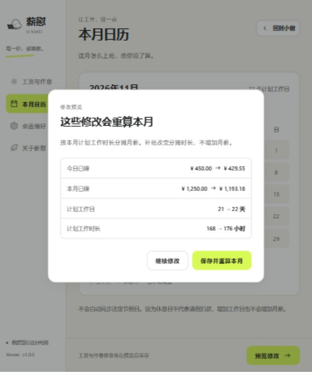

<p align="center"></p>
<h1 align="center">薪慰 Xinwei</h1>
<p align="center"><strong>每一秒，都算数。</strong></p>
<p align="center">Windows 桌面工资进度小玩具 · 本地运行 · 无需账号 · 深浅主题</p>

填好月薪和作息，让工资进度陪你上班。薪慰把「今天已经赚了多少」放进桌面小窗，给普通的工作时间一点即时反馈。“窝囊费”保留为可选的趣味显示名称。

## 看看薪慰

以下是应用的实际渲染截图。展示使用虚构数据：月薪 ¥16,800，周一至周五工作，09:00–12:00、13:00–18:00；时间固定为 2026 年 11 月 3 日 14:30。正式应用使用真实时间。

| 浅色小窗 | 深色小窗 |
| :---: | :---: |
|  |  |

| 午休，收入暂歇 | 隐私模式，隐藏金额 |
| :---: | :---: |
|  |  |

设置工资与作息，修改规则前先查看重算结果：

<table>
<tr>
<td align="center"></td>
<td align="center"></td>
</tr>
<tr><td align="center">工资与作息</td><td align="center">修改前后对照</td></tr>
</table>

<details>
<summary>更多界面：休息日、下班、日历与深色设置</summary>

| 休息日 | 已下班 |
| :---: | :---: |
|  |  |

| 本月日历 | 深色设置 |
| :---: | :---: |
|  |  |

</details>

## 现在能做什么

- **实时工资进度**：查看今日、本月收入估算，以及距离下班的时间。
- **轻量桌面小窗**：拖动、置顶、系统托盘、金额隐藏；设置完成即可回到桌面。
- **自己的工作日历**：月薪、工资口径、每周工作日、上下班和午休时间，以及指定日期的班休调整。
- **修改前先预览**：展示规则调整对当月收入与计划工时的影响，确认后保存。
- **统一视觉**：跟随系统深浅主题，荧光黄绿色强调，搭配手绘伙伴和不同工作状态。
- **本地保存**：无需账号，运行不依赖网络；重启和休眠后按当前时间重新计算。

## 工资怎样计算

将填写的固定月薪分摊到当月计划工作时段：

```text
每秒工资 = 月薪 ÷ 当月计划工作秒数
今日收入 = 每秒工资 × 今日已过去的计划工作秒数
本月收入 = 每秒工资 × 本月已过去的计划工作秒数
```

午休、下班后及休息日不增加收入。内部使用整数精确计算，显示人民币两位小数并四舍五入；日期按北京时间处理。

金额是按设置得到的时间进度估算，不代表实际发薪或到账。当前版本按作息自动计算；**手动上下班打卡、迟到扣减、加班时长统计及打卡互动尚未实现**，将在需求收敛后迭代。

## 项目状态

Windows V1 试用构建与统一视觉已实现。采用 Tauri 2、Vue 3、TypeScript、Vite 和 Vitest，计薪领域逻辑与平台能力分层；macOS 适配计划后续进行。

| 检查 | 本轮结果 |
| --- | --- |
| 前端与组件测试 | 50 项通过 |
| Rust 配置、版本冲突及恢复测试 | 3 项通过 |
| TypeScript 检查与前端生产构建 | 通过 |
| Windows Release 与 NSIS 安装包构建 | 通过 |
| 浏览器视觉检查 | 18 张实际截图，见视觉复查记录 |

Windows 安装卸载、原生交互、200% DPI、多屏与长时稳定性仍待实机验收。完整边界见[本轮交付记录](docs/design/DELIVERY.md)。

## 本地运行

Windows 桌面开发需要 Node.js（本项目使用 22.14）、Rust MSVC 工具链、Visual Studio C++ 构建工具及 Windows SDK、WebView2。

```powershell
git clone https://github.com/codeinsightlab/xinwei-desktop.git
cd xinwei-desktop
npm ci
npm run desktop:dev
```

仅查看前端运行 `npm run dev`，浏览器打开 `http://127.0.0.1:1420/`。

开发模式提供隔离的演示状态，例如 `?preview=working&theme=light`、`?preview=lunch`、`?preview=privacy&theme=dark`；固定时间与演示配置只用于开发，不写入个人配置。

## 测试与构建

```powershell
npm test
cargo test --manifest-path src-tauri/Cargo.toml --lib
npm run build
npm run desktop:build
```

Windows 产物：

```text
src-tauri/target/release/xinwei-desktop.exe
src-tauri/target/release/bundle/nsis/薪慰_1.0.0_x64-setup.exe
```

本地试用副本及校验和保存在 `releases/windows-x64/`，生成产物不提交到源码仓库。缺少 WebView2 的机器在安装时可能需要联网获取运行环境。

## 文档与代码

- [产品需求文档 PRD 1.1](docs/PRD.md)
- [交叉审查记录](docs/PRD-cross-review.md)
- [统一视觉系统](docs/design/VISUAL_SYSTEM.md)
- [视觉复查记录](design-qa.md)
- [本轮交付与验证边界](docs/design/DELIVERY.md)
- [参考与实际界面对照页](docs/design/compare.html)：在本地服务打开可查看，GitHub 展示 HTML 源码。

```text
src/domain/         计薪规则与输入校验
src/application/    应用状态与配置流程
src/features/       设置等界面
src/shared/         金额、状态、进度与角色组件
src/platform/       桌面平台适配
src/styles/         视觉变量与全局样式
src-tauri/          Rust 桌面能力与打包配置
docs/               PRD、设计规范与产品截图
```
